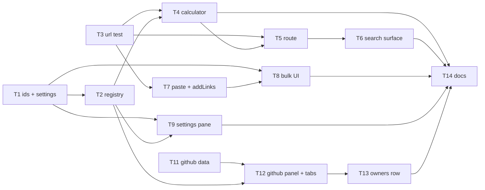

# Implementation plan: pluggable experiments

Spec: [docs/specs/2026-11-14-experiments-design.md](../specs/2026-11-14-experiments-design.md) · ADRs: [0001 superseded](../adrs/0001-github-events-over-ungh.md), [0002](../adrs/0002-github-tracker-uses-ungh.md)

Status: implemented · 2026-11-14

## Objective and scope

Replace the HN one-off flag with one registry of experiment descriptors, then add
four experiments on top of it: a calculator in the search field, bulk pasting of
URLs into a group, a GitHub release and repository tracker, and tabbed sidebars
so two column experiments can coexist. Migrate `experimentalHn` so nobody loses
the setting.

In scope: `src/lib/experiments/*` (new), `github.ts`, `settings.svelte.ts`,
`url.ts`, `board.svelte.ts`, `suggestions.ts` (export only), `App.svelte`,
`context.ts`, `PaletteDialog.svelte`, `TileForm.svelte`,
`SettingsDialog.svelte`, `BulkAddDialog.svelte`, `BulkAddForm.svelte`,
`GithubPanel.svelte`, `SidePanels.svelte`, `HnPanel.svelte`, `app.css`, tests,
docs.

Out of scope: bangs, feed data, plugin runtimes, lifecycle hooks, GitHub
authentication or polling, per-repository follows, per-link title editing in the
bulk flow.

Acceptance: `bun run check`, `bun run test` and `bun run build` pass; each
experiment toggles without a reload; with two column experiments on the sidebar
renders tabs; with HN on, search never overlaps the column heading.

## Architecture and interfaces

Reused: `normalizeUrl` / `titleFromUrl` (`url.ts`), the ten-second undo in
`BoardStore`, `collectUrls` / `canonical` (`suggestions.ts`), ui-sdk `Dialog`,
`Switch`, `Select`, `Textarea`, `Command`, `Tabs`.

```text
src/lib/experiments/
  ids.ts        EXPERIMENT_IDS + ExperimentId; no imports (breaks the settings cycle)
  registry.ts   SearchResolution, ExperimentDefinition, EXPERIMENTS, activeColumns
  route.ts      resolveQuery: URL -> enabled experiments -> engine
  calculator.ts experiment module implementing resolveSearch
  paste.ts      pure parseUrlList + hasMultipleUrls
src/lib/github.ts             events parsing, cache, fetch
src/lib/components/SidePanels.svelte   sidebar host + tabs
src/lib/components/GithubPanel.svelte  tracker column
```

```ts
export interface ExperimentDefinition {
  id: ExperimentId
  title: string
  description: string
  terms: string[]
  column?: boolean
  resolveSearch?: (query: string, context: SearchContext) => SearchResolution | null
}

export const EXPERIMENTS: ExperimentDefinition[] = [hn, calculator, pasteLinks, github]
export function activeColumns(settings: Settings): ExperimentDefinition[]
```

`Settings.experiments` is `Partial<Record<ExperimentId, boolean>>`, written by the
settings pane and read only through `experimentEnabled`. `Settings.githubOwners`
is the tracker's configuration, validated by `readOwners` / `parseOwnerInput`.

`BoardStore.addLinks(groupId, links)` validates everything, builds all tiles,
commits once with one undo snapshot, and returns the count.

`src/lib/github.ts` reads ungh.cc: one repository list per owner (`/orgs/{owner}/repos`,
falling back to `/users/{owner}/repos`) plus releases for the eight most recently
pushed repositories, keeps the last 30 days, and caches items and errors for ten
minutes under `tiles:github:v1`, keyed by the owner set — see ADR 0002. ADR 0001
(public events) is superseded: the events feed was too sparse.

Dependency shape:



## Tasks and dependencies

| ID | Deliverable and boundary | Prerequisites | Completion and verification | Status |
| --- | --- | --- | --- | --- |
| T1 | `experiments/ids.ts`; `Settings.experiments`, defaults, `read()` keep/drop rules, the `experimentalHn`/`experimentalRss` migration; `experimentEnabled`. Tests: defaults, known booleans kept, unknown ids and non-booleans dropped, both old keys migrate, `update()` merges, reset clears. | none | `bunx vitest run src/lib/settings.test.ts` then `bun run check` | done |
| T2 | `registry.ts`: types and the descriptors with titles, one-line descriptions, `terms` and `column`. Tests: ids unique, every id in `EXPERIMENT_IDS`, every definition complete, `calculator` precedes `paste-links`. | T1 | `bunx vitest run src/lib/experiments/registry.test.ts` | done |
| T3 | Export and tighten `looksLikeUrl` (scheme / dotted host with alphabetic last label / IPv4); `searchTarget` reuses it. Tests: `1.5*2`, `2.55`, `0.1+0.2`, `2^10` are not URL-shaped; `example.com`, `sub.example.co.uk/path?q=1`, `example.com:8080`, `https://example.com`, `192.168.1.10` still are. | none | `bunx vitest run src/lib/url.test.ts` | done |
| T4 | `expr-eval` + `@types/expr-eval`; `calculator.ts` with the trigger rules and number formatting. Tests: precedence, parentheses, unary minus, `%`, `^`, `sqrt`, `1/3`, `1/0`, `1e20`, `1e-7`, bare `2026`, `911`, `2+`, `hello`, empty, `2 + 2`. | T2, T3 | `bunx vitest run src/lib/experiments/calculator.test.ts` | done |
| T5 | `route.ts` `resolveQuery`: empty → null; URL-shaped → navigate; enabled experiments in registry order; engine fallback. Tests cover each branch. | T2, T3, T4 | `bunx vitest run src/lib/experiments/route.test.ts` | done |
| T6 | Search surface. **Superseded during implementation:** the standalone overlay was merged into `PaletteDialog`, which now owns type-to-open, `/`, `Ctrl/Cmd+F`, the resolved action from `resolveQuery`, matching tiles and commands. The overlap is gone because search is a dialog. Tests: typing opens the palette with the character, `18*3` offers `Copy 54` and copies it, results do not filter the board. | T5 | `bunx vitest run src/App.test.ts` | done |
| T7 | Export `canonical`; `paste.ts` `parseUrlList` (50 cap, both dedupe directions, invalid count, hostname titles) and `hasMultipleUrls`; `BoardStore.addLinks`. Tests: whitespace/newlines, bare hosts, duplicates, invalid tokens, overflow, unknown group → 0, one undo entry for N links, no snapshot when nothing was added. | T3 | `bunx vitest run src/lib/experiments/paste.test.ts src/lib/board.test.ts` | done |
| T8 | `BulkAddDialog` + `BulkAddForm`; `AppActions.openBulkAdd`; palette item **Add links…** behind the flag; `TileForm` hands a 2+ URL paste in the group-level URL field to the dialog and `App` opens it after the tile dialog closes. Tests: item hidden when disabled; pasting 3 URLs adds 3 tiles with one undo entry; folder dialog untouched. | T7, T1 | `bunx vitest run src/App.test.ts` | done |
| T9 | Settings → Advanced → Experimental maps `EXPERIMENTS` (title, description, `Switch`, merged `terms`, pane hidden when empty); `App.svelte` derives columns from the registry. Tests: every entry rendered; toggling persists `experiments.<id>`. | T1, T2 | `bunx vitest run src/App.test.ts` | done |
| T10 | `github.ts`: `parseRepos`, `repoItems`, `parseReleases`, `relativeTime`, `fetchOwner`, `fetchOwners`, `loadFeed` / `refreshFeed`, ten-minute cache keyed by owners. Tests: repository mapping and the 30-day window, release tags and the tag URL, org → user fallback, the eight-repository release scan, a failed release request, merge/sort/cap, cache hit with errors, foreign owner set, poisoned entries, empty results, aborted fetch, stale fallback. | T2 | `bunx vitest run src/lib/github.test.ts` | done |
| T11 | `GithubPanel.svelte` (heading, count, refresh, one row per repository via `latestPerRepo`, empty/loading/error, owners hint) and `SidePanels.svelte` (single panel, or ui-sdk `Tabs` with `keepMounted` for two or more), `App.svelte` renders `SidePanels` with `with-panel`. Tests: two enabled columns render both tabs; switching shows the other panel and its release item without a second fetch. | T10 | `bunx vitest run src/App.test.ts` | done |
| T12 | `Settings.githubOwners` validation and `parseOwnerInput`; owners row in the Experimental pane when the tracker is on. Tests: defaults, invalid and duplicate owners dropped, ten-owner cap, the field persists parsed owners. | T2, T5 | `bunx vitest run src/lib/settings.test.ts src/App.test.ts` | done |
| T13 | Docs sync: `README.md`, `docs/user/getting-started.md` + `keyboard.md`, `AGENTS.md` invariants and structure block, spec and ADR. | T6, T8, T9, T11, T12 | `bun run check && bun run test && bun run build`; docs describe what shipped | done |

## Verification strategy

- Unit, in-repo Vitest: settings migration and owner parsing, the tightened URL
  test, calculator rules, route order, paste parsing, `addLinks` atomicity, the
  GitHub event mapping, cache and failure handling. Example tests only; inputs
  are small and the acceptance criteria are exact.
- Integration: `App.test.ts` covers the user flows through the real components —
  palette search and calculator, bulk paste with undo, experiment toggles, the
  owners field, and the two-tab sidebar.
- Manual, with `bun run dev`: HN and GitHub on → tabs; paste 3 URLs + 1 duplicate;
  `18*3` copies 54; toggle each experiment off.
- Build: `bun run build` confirms `expr-eval` in the bundle and the service
  worker still precaching the shell.

## Risks, rollback, assumptions, and open questions

- **`expr-eval` is unmaintained (2020) with older types.** The published
  declarations work for 2.x; `as any` is not used. Contained to one module.
- **The tightened URL test changes existing behaviour.** `1.5*2` and `2.55` used
  to navigate to bogus hosts; they now search or calculate. `url.test.ts` pins
  the new contract.
- **GitHub request budget.** The ten-minute cache, the owner-set key and the cap
  of eight release lookups per owner bound the work per refresh (9 requests per
  owner). A release from a repository outside that set is missed until it is
  pushed again; documented in ADR 0002.
- **Rollback.** Each task was a separate step; reverting the code restores the
  old boolean read path for settings written before the change. A toggle made
  after it is lost, the board is not. `tiles:v1` needs no rollback.
- **Open:** exact summary copy and icons remain the builder's.
